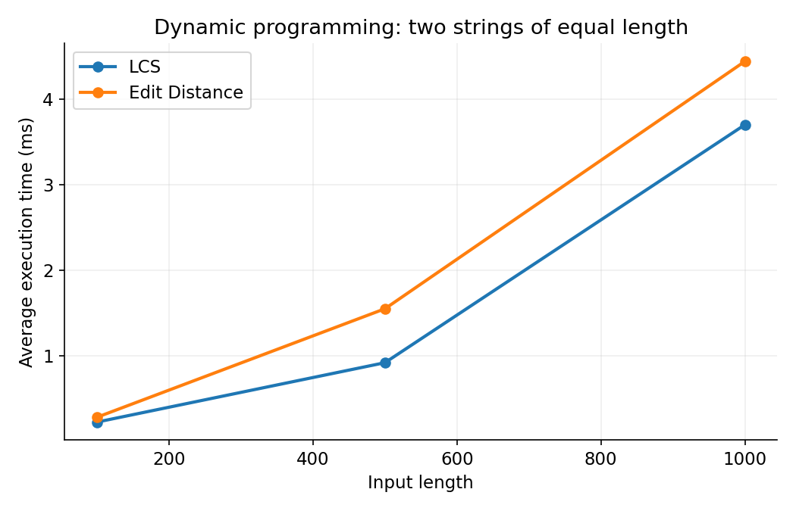
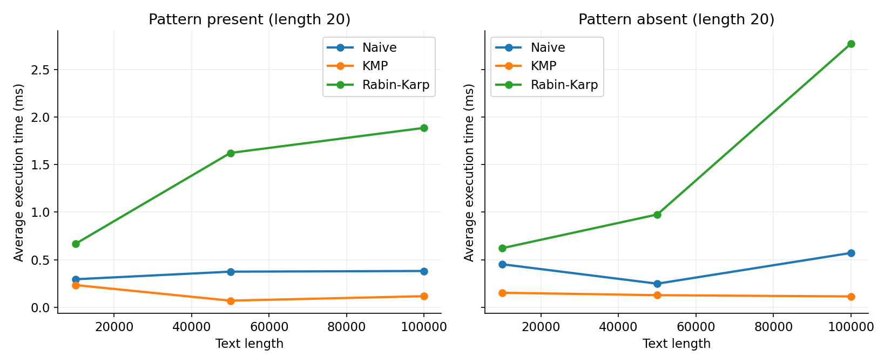
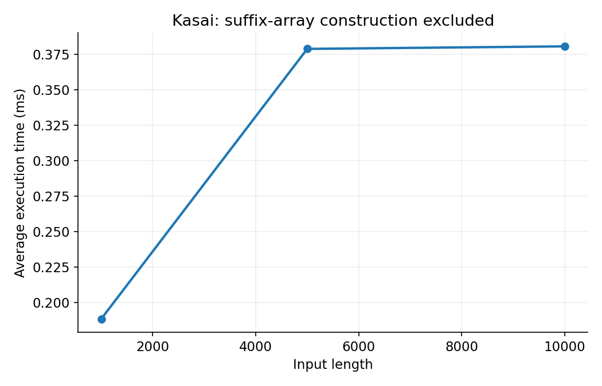

# Text Analysis: Dynamic Programming and String Algorithms

## 1. Build and run

Install **JDK 17 or newer** (not just a JRE). No Maven, Gradle, or external Java dependencies are needed. Run from the repository root:

```sh
mkdir -p out
javac -d out src/textanalysis/*.java
java -cp out textanalysis.AlgorithmTests
java -cp out textanalysis.Main
java -cp out textanalysis.Benchmark
```

To regenerate the plots, install Python 3 and matplotlib, then run:

```sh
python -m pip install matplotlib
python scripts/plot_results.py
```

Alternatively, `sh scripts/run.sh` on Linux/macOS or `./scripts/run.ps1` in PowerShell compiles, tests, demonstrates, benchmarks, and plots everything. The shell script invokes the compiler module through `java`; this is equivalent to `javac`. The committed plots can be viewed without installing Python.

### Repository organization

| Path | Purpose |
| --- | --- |
| `src/textanalysis/Lcs.java` | Full-table LCS |
| `src/textanalysis/EditDistance.java` | Full-table Levenshtein distance |
| `src/textanalysis/StringMatching.java` | Naive, KMP and rolling-hash Rabin-Karp |
| `src/textanalysis/MatchResult.java` | Immutable indices and comparison counts |
| `src/textanalysis/Kasai.java` | LCP from a supplied suffix array |
| `src/textanalysis/SuffixArrays.java` | Simple experimental suffix-array generator |
| `src/textanalysis/AlgorithmTests.java` | Deterministic and randomized tests |
| `src/textanalysis/Benchmark.java` | Reproducible measurements and CSV output |
| `src/textanalysis/Main.java` | Small runnable demonstration |
| `results/` | Raw runs, averages, environment, test output and plots |
| `scripts/` | Run commands and plot generation |

## 2. Implementation decisions and assumptions

- Inputs are non-null Java strings. Comparisons are case-sensitive, with no normalization. Characters and indices refer to UTF-16 code units, not Unicode code points or grapheme clusters.
- Empty LCS input gives 0. Edit distance from an empty string is the length of the other string. Each insertion, deletion and substitution costs 1.
- Matching returns **all zero-based indices**, in ascending order, including overlapping occurrences. An empty pattern matches all `n + 1` boundaries. A pattern longer than the text returns an empty list.
- Matching calls include preprocessing, scanning, counting and result construction. `MatchResult` copies its list to make the result immutable.
- Rabin-Karp uses base 65,536 and modulus 1,000,000,007. A hash equality is always verified character by character. Products fit in signed Java `long` for these constants. Modular subtraction is normalized before the next update.
- Kasai takes a lexicographically sorted suffix array as input. It validates length, range and uniqueness, but sorted order is a caller precondition. It returns `lcp[0] = 0`, and `lcp[r]` is the common-prefix length of suffixes `sa[r-1]` and `sa[r]`. No sentinel character is added.
- The suffix-array helper compares suffixes without allocating substrings. Its worst-case time is O(n^2 log n), with O(n) auxiliary storage. It is only an input generator and is excluded from Kasai timing. Suffix-array construction was not required.

## 3. Recurrences and correctness

### Longest Common Subsequence

Let `D[i][j]` be the LCS length of the first `i` characters of A and first `j` characters of B.

```text
D[0][j] = D[i][0] = 0
D[i][j] = D[i-1][j-1] + 1                       if A[i-1] == B[j-1]
D[i][j] = max(D[i-1][j], D[i][j-1])             otherwise
```

An empty prefix has no nonempty subsequence. If the last characters match, an optimal common subsequence can include that shared final character and extend an optimal solution for the smaller prefixes. If they differ, a common subsequence must omit at least one of them, so the maximum of the two exclusions is optimal. Induction over increasing prefix lengths proves every cell correct. The answer is `D[a.length()][b.length()]`.

### Edit Distance

Let `E[i][j]` be the minimum cost to transform A's prefix of length `i` into B's prefix of length `j`.

```text
E[i][0] = i; E[0][j] = j
cost = 0 if A[i-1] == B[j-1], otherwise 1
E[i][j] = min(E[i-1][j] + 1, E[i][j-1] + 1, E[i-1][j-1] + cost)
```

The boundary cases require deleting or inserting every character. An optimal alignment ends with deletion, insertion, or a match/substitution. These alternatives are exhaustive, and each leaves an optimal smaller-prefix problem; otherwise its prefix could be replaced by a cheaper solution. The recurrence takes their minimum. Filling in row order ensures all dependencies are ready.

### String matching

**Naive:** visit every valid alignment and compare left to right. A reported alignment has all `m` equal characters, and no possible start is skipped.

**KMP:** `lps[j]` stores the longest proper prefix of the pattern that is also a suffix of its prefix ending at `j`. During search, `j` is the length of the matched pattern prefix. After a mismatch, `lps[j-1]` is the longest remaining possible prefix, so already matched text need not be reread. Each fallback shortens `j`, while the text cursor never moves backward. After a full match, falling back to `lps[m-1]` retains overlapping matches. The same border invariant builds the LPS array.

**Rabin-Karp:** polynomial hashes are built for the pattern and first window. For each shift, subtract the outgoing character times `base^(m-1)`, multiply by the base, and add the incoming character, all modulo the modulus. This preserves the next window's hash. Every real occurrence has the same hash as the pattern. False hash matches are rejected by exact comparison, so collisions affect performance, never correctness.

### Kasai and a manual example

For `banana`:

| Rank | Suffix start | Suffix | LCP with previous suffix |
| --- | --- | --- | --- |
| 0 | 5 | a | 0 |
| 1 | 3 | ana | 1 |
| 2 | 1 | anana | 3 |
| 3 | 0 | banana | 0 |
| 4 | 4 | na | 0 |
| 5 | 2 | nana | 2 |

Thus `sa = [5,3,1,0,4,2]` and `lcp = [0,1,3,0,0,2]`.

Kasai first constructs inverse ranks, then visits suffix starts in text order. If a suffix and its lexicographic predecessor share `h` characters, removing their first characters preserves at least `h-1` common characters. The predecessor of the next suffix in sorted order shares at least this retained prefix as well. Therefore the next comparison may start at `max(h-1,0)`. Extending until a mismatch gives the exact LCP. At rank zero there is no predecessor and the height resets to zero. Across the entire scan the height increases only O(n) times because it decreases at most once per text position (the single rank-zero reset adds at most O(n) more). Thus repeated comparisons do not create a quadratic scan.

## 4. Complexity analysis

Let `a,b` be DP input lengths, `n` the text length, `m` the pattern length, and `z` the number of returned indices. Matching bounds below assume `1 <= m <= n`; materialized output requires O(z) space in addition to the auxiliary space shown.

| Algorithm | Main operation | Preprocessing | Best time | Worst time | Auxiliary space excluding output | Justification |
| --- | --- | --- | --- | --- | --- | --- |
| LCS | Equal: diagonal + 1; unequal: max of exclusions | Table allocation | Theta((a+1)(b+1)) | Theta((a+1)(b+1)) | Theta((a+1)(b+1)) | Every interior cell is evaluated; full table is retained. For positive lengths, Theta(ab). |
| Edit Distance | Min of deletion, insertion, substitution/match | Initialize empty-prefix boundaries | Theta((a+1)(b+1)) | Theta((a+1)(b+1)) | Theta((a+1)(b+1)) | Full table and constant work per cell, including boundaries. |
| Naive | Compare each alignment | O(1) | Theta(n-m+1+z) | O((n-m+1)m+z) | O(1) | First-character failure is cheapest; repeated prefixes can require m comparisons per alignment. |
| KMP | LPS border fallback | Theta(m), O(m) space | Theta(n+m+z) | Theta(n+m+z) | O(m) | LPS and text scans have amortized linear work. |
| Rabin-Karp | Rolling hash plus exact verification | Theta(m) | Theta(n+m+z) | O(n+m+(n-m+1)m+z) | O(1) | Each shift is constant arithmetic; every hash hit can require m character checks. |
| Kasai | Inverse ranks and retained common-prefix height | Theta(n) | Theta(n) | Theta(n) | Theta(n) | Rank/permutation validation and amortized linear scan; output is n integers. |

Rabin-Karp is often described as expected O(n+m), assuming well-distributed hashes, few collisions and few expensive true matches. More precisely it is O(n+m+V+z), where V is the total number of character checks over hash hits. Under an ideal uniform hash assumption, false-hit verification contributes at most O((n-m+1)m/q) in expectation for modulus q, plus O(zm) for true matches. This implementation has a fixed deterministic hash, so no probabilistic guarantee holds for adversarial inputs. Many genuine overlapping matches can also cause quadratic verification even without collisions.

For `m > n`, all three implementations return immediately in O(1). For `m = 0`, all three use Theta(n+1) time and output space. Empty DP boundaries are covered by the `(a+1)(b+1)` form. No implementation uses the optional linear-space DP optimization because the assignment requests a DP table.

## 5. Testing strategy and results

Tests use explicit checks that throw `AssertionError`, independent of Java's `-ea` flag. The committed run passed **1,253 assertions**, including 300 fixed-seed randomized trials.

| Area | Cases |
| --- | --- |
| LCS | Identical, disjoint, empty left/right, known nontrivial result |
| Edit Distance | Identical, empty left/right, substitution, insertion, deletion, kitten/sitting |
| Matching | Beginning, middle, end, multiple and overlapping matches, absent, longer pattern, empty pattern, empty text, non-ASCII BMP characters |
| Cross-algorithm checks | Every matching case checks all three lists against the same expected list; randomized cases compare KMP/Rabin-Karp to Naive |
| Hash collisions | Modulus 2 deliberately makes `c` collide with `a`; only the actual `a` is returned |
| Kasai | Manual banana example, empty, singleton, repetitive string, invalid permutations, 300 random comparisons against direct adjacent-suffix LCP |

`results/tests.txt` contains the actual test output. Randomized tests complement, rather than replace, manually specified expected answers. Additional pre-timing checks ensure all three matchers agree for every benchmark workload.

## 6. Experimental setup

- Fixed seed: **20261101**, `java.util.Random`.
- Alphabet: **abcdefghijklmnopqrstuvwxyz** for all random inputs. Test-only examples additionally cover other characters.
- DP: two equal-length independently generated strings at **100, 500, 1000**. LCS and Edit Distance receive the exact same pair at each size.
- Matching: text lengths **10000, 50000, 100000**, pattern length **20**. The present pattern is a substring starting at `n/2`. An absent pattern is drawn from the same alphabet and regenerated until absence is verified outside timing. Each algorithm receives exactly the same text and pattern for a comparison; both scenarios use the same text at each size.
- Kasai: string lengths **1000, 5000, 10000**. Suffix-array construction occurs before timing.
- Each workload receives **20 untimed warmup calls**, then exactly **5 timed calls**, using `System.nanoTime()`; arithmetic mean is reported in milliseconds. Raw nanosecond measurements are committed in `results/raw.csv`.
- Input generation, validation checks, file I/O, formatting, console output, and result consumption occur outside each timed region. Timed work includes the algorithm invocation, its allocations and result construction, instrumentation, and minor supplier/boxing overhead. Results are consumed via a volatile sink after the timer to discourage elimination.
- Comparison counts are deterministic per workload and collected from an additional untimed call. They count character equality/inequality checks, separately for KMP preprocessing and search. Rabin-Karp counts exact verification only; hash arithmetic and hash equality checks are **not** character comparisons. Zero does not mean zero computational work. DP and Kasai comparison fields are unused (0), not claims of no operations.
- This is a small educational benchmark, not JMH: scheduling noise, JIT compilation and garbage collection are not isolated. Algorithm order is fixed. Five samples and local warmup do not establish statistical confidence or guarantee monotonic curves.

Recorded environment:

```text
Java: 17.0.20+8-1-24.04-Ubuntu
VM: OpenJDK 64-Bit Server VM
OS: Linux amd64
Available processors: 8
Seed: 20261101
Alphabet: abcdefghijklmnopqrstuvwxyz
Warmup calls per workload: 20
Timed runs: 5
```

## 7. Measured results

These are measured execution times from this implementation, not theoretical complexity estimates. Raw data and machine-readable averages are included.

### Dynamic programming

| Input length (both strings) | LCS average (ms) | Edit Distance average (ms) |
| --- | --- | --- |
| 100 | 0.221262 | 0.277996 |
| 500 | 0.916862 | 1.548609 |
| 1000 | 3.704011 | 4.446617 |



### String matching

Comparison counts below are per invocation; timings include preprocessing.

| Scenario | Text length | Algorithm | Average (ms) | Preprocessing character checks | Search character checks |
| --- | --- | --- | --- | --- | --- |
| present | 10000 | Naive | 0.294717 | 0 | 10415 |
| present | 10000 | KMP | 0.234091 | 19 | 10398 |
| present | 10000 | Rabin-Karp | 0.666322 | 0 | 20 |
| absent | 10000 | Naive | 0.452170 | 0 | 10392 |
| absent | 10000 | KMP | 0.152941 | 20 | 10394 |
| absent | 10000 | Rabin-Karp | 0.621665 | 0 | 0 |
| present | 50000 | Naive | 0.374611 | 0 | 51999 |
| present | 50000 | KMP | 0.070055 | 21 | 51925 |
| present | 50000 | Rabin-Karp | 1.621772 | 0 | 20 |
| absent | 50000 | Naive | 0.248358 | 0 | 52045 |
| absent | 50000 | KMP | 0.127483 | 21 | 51968 |
| absent | 50000 | Rabin-Karp | 0.975181 | 0 | 0 |
| present | 100000 | Naive | 0.381627 | 0 | 103935 |
| present | 100000 | KMP | 0.116854 | 19 | 103789 |
| present | 100000 | Rabin-Karp | 1.885074 | 0 | 20 |
| absent | 100000 | Naive | 0.571268 | 0 | 103900 |
| absent | 100000 | KMP | 0.114328 | 22 | 103776 |
| absent | 100000 | Rabin-Karp | 2.769267 | 0 | 0 |



### Kasai

| String length | Average (ms) |
| --- | --- |
| 1000 | 0.188406 |
| 5000 | 0.378717 |
| 10000 | 0.380500 |



## 8. Discussion

Both DP algorithms do quadratic work when the two input lengths grow together. Going from length 500 to 1000 increases the cell count fourfold. LCS rose from about 0.92 to 3.70 ms; Edit Distance rose from about 1.55 to 4.45 ms. The ratios are not exactly four because allocation, cache behavior, JIT and runtime noise affect elapsed time. The 100-character cases are particularly short and poorly suited to inferring scaling. Both implementations retain the full table; an approximately million-cell integer table is about 4 MB of cell payload at length 1000, plus row/object overhead.

For random 26-letter text, Naive usually rejects an alignment on its first character, so its measured character counts are approximately 1.04n. Its simplicity makes it competitive despite a worse worst-case bound. KMP search counts are also about 1.04n and preprocessing costs only 19-22 checks for these patterns. KMP is faster at the largest measured size here, but the nonmonotonic small-input measurements demonstrate warmup/noise effects; this should not be generalized into a universal speed ranking.

Rabin-Karp performed 20 verification character checks for each present workload and zero for each absent workload. Nevertheless it was slower than the other matchers in these measurements: modular rolling-hash arithmetic is done at every shift. Character checks alone are not a fair universal measure of work across algorithms. These datasets do not demonstrate the collision-heavy or repetitive-input worst case. The forced-collision correctness test verifies rejection behavior without pretending to characterize worst-case performance.

Kasai time increased from about 0.188 ms at length 1000 to 0.381 ms at length 10000. This is qualitatively compatible with linear scanning, but a tenfold size increase did not yield tenfold time because short runs contain substantial runtime effects. The proof, rather than three data points, establishes its linear bound. Reported times intentionally exclude the much less efficient comparator-based suffix-array construction.

## 9. Conclusion

LCS measures preserved order without requiring contiguity; Edit Distance measures the cost of transforming one string into another. Both full-table implementations offer clear recurrences at quadratic time and space cost. Naive matching is easy to implement and competitive on random text, KMP provides deterministic linear matching with an LPS array, and Rabin-Karp replaces many character checks with hashing but must verify every hit. Kasai efficiently builds an LCP array once a valid suffix array is available. Theoretical bounds describe growth and adversarial cases; measured timings describe this specific workload and runtime.

## 10. Submission checklist and meaningful commits

Upload the contents of this project to a GitHub repository, then submit its repository URL through Moodle. A separate PDF report is not required. Keep the source, tests, README, CSV data and PNG plots together.

Suggested commit stages while reviewing and uploading the files:

1. `Implement full-table LCS and edit distance`
2. `Implement naive, KMP and Rabin-Karp matching`
3. `Add Kasai LCP and suffix-array input helper`
4. `Add edge-case, collision and randomized tests`
5. `Add reproducible benchmarks and measured results`
6. `Document complexity, results and algorithm trade-offs`

These are suggested stages, not a claim that GitHub commits have already been created. For the defence, be ready to derive both recurrences, explain LPS fallback and collision verification, trace the banana LCP example, and distinguish comparison counts from elapsed time.
